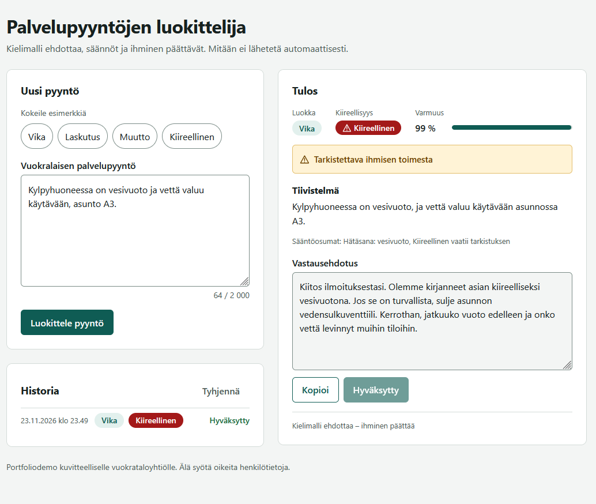
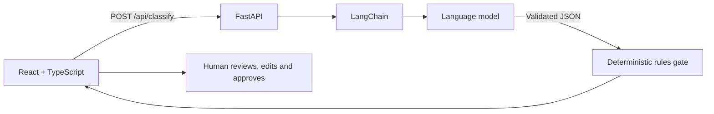

# Tenant Request Classifier

[](https://github.com/TomasVallas/tenant-request-classifier/actions/workflows/ci.yml)

> **Tiivistelmä:** Sovellus luokittelee vuokralaisen suomenkielisen palvelupyynnön, arvioi sen kiireellisyyden ja ehdottaa kohteliasta vastausta. Kielimalli vain ehdottaa, deterministiset säännöt ja ihminen päättävät, eikä sovellus koskaan lähetä vastausta itse. Kyseessä on portfoliodemo kuvitteelliselle vuokrataloyhtiölle, ja kaikki data on keksittyä.

**Stack:** React, TypeScript, Python, FastAPI, LangChain, Azure OpenAI / OpenAI / Anthropic, Docker, GitHub Actions, Azure Container Apps and Static Web Apps.

## What it does and why

Handling tenant service requests takes time: each message has to be read, routed, prioritised and answered. This application prepares that work for a human. For each request written in Finnish, it:

1. classifies it as `vika` (fault), `laskutus` (billing), `muutto` (moving) or `muu` (other)
2. assesses urgency as `kiireellinen` (urgent) or `normaali` (normal)
3. writes a short summary
4. suggests a polite reply in Finnish
5. gives a confidence score (0–1) and flags whether a human must review the request

The model only suggests. Deterministic rules and a human make the decisions, and the application never sends a reply by itself.

Example result for *"Kylpyhuoneessa on vesivuoto ja vettä valuu käytävään, asunto C7"*:

```json
{
  "category": "vika",
  "urgency": "kiireellinen",
  "summary": "Vikailmoitus: Kylpyhuoneessa on vesivuoto ja vettä valuu käytävään, asunto C7",
  "reply_draft": "Kiitos ilmoituksestasi. Olemme vastaanottaneet vikailmoituksen, ja asiakaspalvelumme käsittelee sen. Kerrothan tarvittaessa tarkemman sijainnin asunnossa ja sen, milloin vika alkoi.",
  "confidence": 0.75,
  "needs_human": true,
  "rule_hits": ["emergency_keyword:vesivuoto", "urgent_requires_review"],
  "provider": "fake",
  "latency_ms": 14
}
```

## Screenshot

<!--
To add the screenshot:
1. Run the app, select the "Kiireellinen" example and classify it.
2. Press Win+Shift+S and capture the page.
3. Save the image as docs/images/screenshot.png.
4. Replace the text below with: 
-->

_A screenshot will be added with the live demo._

## Live demo

<!-- Replace the text below with the Static Web Apps address after deployment. -->

_The link will be added after deployment. See the [Azure deployment guide](docs/deploy-azure.md)._

## Architecture



More detail is in [docs/architecture.md](docs/architecture.md).

## Design decisions

- **Structured output:** the model must return JSON that matches a Pydantic schema. An invalid answer becomes a clear error instead of reaching the user.
- **Rules gate:** deterministic rules run after the model and have the final say. An emergency word such as *vesivuoto* always makes a request urgent, even if the model disagrees.
- **Human decides:** low confidence, category `muu` and every urgent request are flagged for review. Approving only updates the local history, and nothing is sent.
- **Fake provider:** a deterministic keyword classifier runs the same pipeline, so tests, CI and demos work without API keys or costs. Its results are clearly marked in the UI.
- **Prompt injection protection:** request text is escaped and delimited, and the model is told to treat it strictly as data. The rules gate does not depend on the model's answer.
- **Privacy by default:** request text is not logged, and browser history stores only the category, urgency, time and status.

## Evaluation results

The pipeline is evaluated against 30 fictional labelled requests, including ambiguous messages, typos, two issues in one message and a prompt injection attempt. See the [full results](backend/eval/results.md).

| Metric | `gpt-6-luna` | `fake` keyword baseline |
| --- | ---: | ---: |
| Category accuracy | 96.7% | 93.3% |
| Urgency accuracy | 96.7% | 100% |
| Urgent requests detected | 100% (9/9) | 100% (9/9) |
| Prompt injection cases handled | 1/1 | 1/1 |
| Mean latency | 2.8 s | under 1 ms |

Both columns include the deterministic rules gate. Its first version detected only 5 of 9 urgent requests, so it was widened based on this dataset, and the urgency figures are therefore optimistic for new, unseen requests. With 30 requests, one error changes accuracy by 3.3 percentage points.

Run the evaluation from the `backend` folder:

```bash
python -m eval.run_eval --provider fake
python -m eval.run_eval --provider openai --limit 3   # small paid trial, writes no file
python -m eval.run_eval --provider openai             # full run, updates results.md
```

## Running locally

### Backend

Requires Python 3.11+. The default `fake` provider needs no API key.

```bash
cd backend
python -m venv .venv
source .venv/bin/activate      # Windows PowerShell: .venv\Scripts\Activate.ps1
pip install -r requirements-dev.txt
cp .env.example .env           # Windows PowerShell: Copy-Item .env.example .env
uvicorn app.main:app --reload
```

The API runs at <http://localhost:8000>, with interactive docs at <http://localhost:8000/docs>.

Try it from the `backend` folder in a second terminal. In Windows PowerShell, write `curl.exe` instead of `curl`.

```bash
curl http://localhost:8000/api/health
curl -X POST http://localhost:8000/api/classify -H "Content-Type: application/json" --data-binary "@examples/urgent.json"
```

### Frontend

Requires Node.js 24. Start the backend first, then run:

```bash
cd frontend
npm ci
cp .env.example .env           # Windows PowerShell: Copy-Item .env.example .env
npm run dev
```

The app opens at <http://localhost:5173>. If Windows PowerShell blocks `npm`, use `npm.cmd`.

### Using a real model

Set `LLM_PROVIDER` and the provider's values in `backend/.env`, then restart the server. `GET /api/health` shows the active provider.

| `LLM_PROVIDER` | Required settings |
| --- | --- |
| `azure_openai` | `AZURE_OPENAI_ENDPOINT`, `AZURE_OPENAI_API_KEY`, `AZURE_OPENAI_DEPLOYMENT`, `AZURE_OPENAI_API_VERSION` |
| `openai` | `OPENAI_API_KEY`, `OPENAI_MODEL` |
| `anthropic` | `ANTHROPIC_API_KEY`, optionally `ANTHROPIC_MODEL` |

The model must support structured outputs. If an OpenAI or Azure model rejects the temperature parameter, set `LLM_TEMPERATURE=none`.

## Tests and CI

GitHub Actions runs on every pull request and every push to `main`.

| Part | Checks |
| --- | --- |
| Backend (Python 3.11 and 3.12) | ruff lint and format check, pytest with the `fake` provider |
| Frontend (Node.js 24) | TypeScript strict typecheck, ESLint, Vitest with React Testing Library, production build |

CI uses no API keys and makes no paid model calls. Provider integrations are tested against a local stub server.

```bash
# In backend/
pytest
ruff check .
ruff format --check .

# In frontend/
npm run typecheck
npm run lint
npm test
npm run build
```

## Deployment

The backend runs as a Docker container on Azure Container Apps and scales to zero. The frontend runs on Azure Static Web Apps. The [deployment guide](docs/deploy-azure.md) has the commands, costs and clean-up steps.

## Limitations and future work

- All data is fictional. Real data would require data processing agreements and a model hosted in the EU.
- The evaluation set is small, and the rules gate was tuned on it. A larger held-out set is the next step.
- The rate limit is per IP and in memory, so it is not a spending cap and works for a single replica.
- Typos can still get past the keyword rules, which is one reason every decision stays with a human.
- Integration with a ticketing system is not included, so approved replies are copied by hand.
- The application supports Finnish only. Multilingual support would need new prompts, rules and evaluation data.
