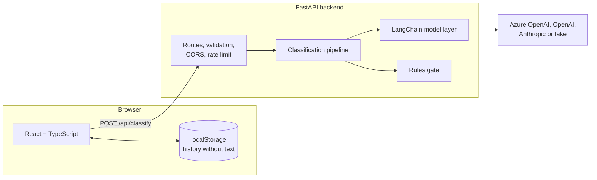
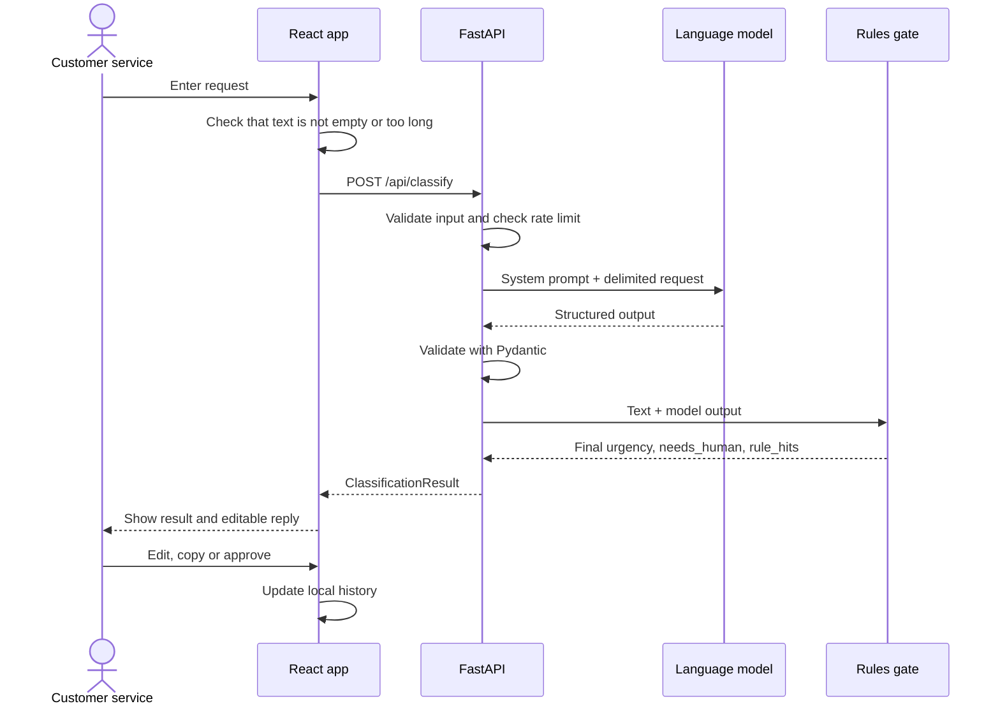
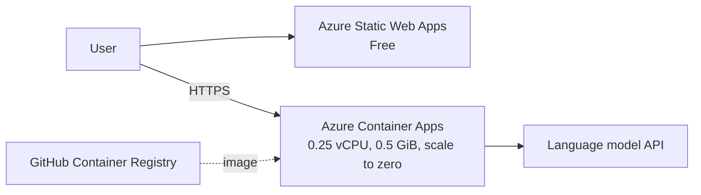

# Architecture

The application helps customer service staff handle tenant requests. A language model suggests a classification and a reply, deterministic rules correct the safety-critical parts, and a human makes the final decision. The application never sends a message.

## System overview

## Request flow

## Backend

| Module | Responsibility |
| --- | --- |
| `app/main.py` | FastAPI app, routes, CORS and error responses |
| `app/config.py` | Settings from environment variables, with API keys stored as secret values |
| `app/schemas.py` | Request and response models |
| `app/prompts.py` | System prompt, few-shot examples and safe delimiting of request text |
| `app/llm.py` | Provider selection, fake classifier and structured model call |
| `app/classifier.py` | Pipeline from model to rules to result, with timeout and logging |
| `app/rules.py` | Deterministic rules as pure functions |
| `app/rate_limit.py` | In-memory sliding window limit per client IP |
| `eval/run_eval.py` | Accuracy, confusion matrices and latency on the labelled dataset |

### Rules gate

The rules run after the model and have the last word.

| Rule | Effect |
| --- | --- |
| Emergency word found | Urgency becomes `kiireellinen`, whatever the model said |
| Confidence below 0.6 | `needs_human = true` |
| Category is `muu` | `needs_human = true` |
| Urgency is `kiireellinen` | `needs_human = true` |

Emergency patterns use Finnish word stems and also match text typed without ä or ö. They lean towards matching, because a false alarm costs one human review while a missed emergency is worse.

### Model layer

Every provider, including the fake one, goes through the same structured output interface. The provider is selected with `LLM_PROVIDER`, and provider packages are imported only when selected.

| Provider | Notes |
| --- | --- |
| `fake` | Deterministic keyword classifier, used in tests, CI and demos without a key |
| `openai` | `ChatOpenAI` with JSON schema output |
| `azure_openai` | `AzureChatOpenAI` with JSON schema output |
| `anthropic` | `ChatAnthropic` with JSON schema output and low effort. The current API rejects `temperature` and forced tool calls |

Limits such as the confidence range live in Pydantic validators instead of JSON Schema keywords, because providers support different schema keywords.

## Frontend

| Module | Responsibility |
| --- | --- |
| `App.tsx` | Shared state, API call, and loading, error, empty and result states |
| `components/ExampleButtons.tsx` | Fills the form with example requests |
| `components/RequestForm.tsx` | Text input, character counter and validation |
| `components/ResultCard.tsx` | Result, human review notice, editable reply, copy and approve |
| `components/HistoryList.tsx` | Processed requests and clear button |
| `api.ts` | Typed API client with runtime response validation |
| `history.ts` | Safe `localStorage` access |
| `useBackendWakeUp.ts` | Wakes a sleeping backend when the page opens and reports startup |
| `types.ts` | Types that mirror the backend schema |

## Security and privacy

- **Prompt injection:** request text is HTML-escaped so that it cannot close its `<request>` delimiter, and the system prompt treats it as data. The model has no tools, and its output is validated.
- **Secrets:** API keys exist only in `.env` locally and in Container Apps secrets in Azure. The frontend knows only the backend address.
- **Logging:** logs contain category, urgency, review flag and latency, never the request text. Model errors log only the error type.
- **Browser storage:** history contains no request text, summary or reply.
- **CORS:** production allows only the configured frontend origin.
- **Rate limit:** behind Azure's proxy, the limit uses the rightmost `X-Forwarded-For` entry because clients can spoof the entries to its left.
- **Container:** the image runs as a non-root user, and an allowlist keeps `.env` out of the build.

## Failure handling

| Situation | Response |
| --- | --- |
| Empty, too long or malformed request | 422 with a clear Finnish message |
| Too many requests | 429 with `Retry-After` |
| Model error, invalid output or 20 s timeout | 503 with a clear Finnish message |
| Backend unreachable or slow | Frontend shows a connection or timeout message |
| `localStorage` blocked or corrupted | App keeps working without saved history |

## Deployment

The steps are in the [deployment guide](deploy-azure.md).

## Trade-offs

| Decision | Reason | Limitation |
| --- | --- | --- |
| Rules after the model | Safety does not depend on model behaviour | Keyword rules can miss unusual wording |
| In-memory rate limit | No extra service for a demo | Works per replica and resets on restart |
| Scale to zero | Almost free when idle | A cold start takes about 25 s, so the page wakes the backend on load with a free health check and shows a notice |
| History in `localStorage` | No database or stored personal data | Stays in one browser |
| One request at a time in evaluation | Simple and easy to measure | Slower on large datasets |
