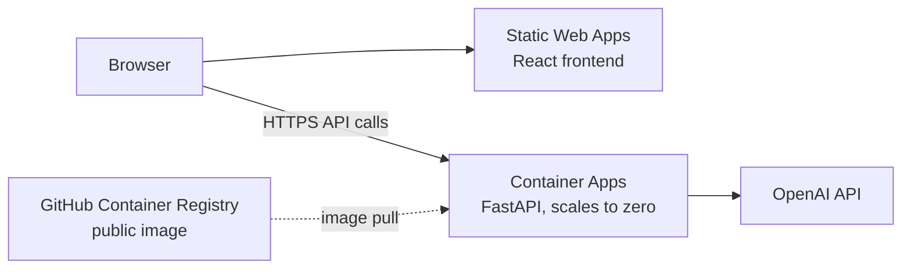

# Deploying to Azure

This guide publishes the backend to Azure Container Apps and the frontend to Azure Static Web Apps. Run the commands in one Windows PowerShell window, starting from the repository root, so that the variables stay available.



## Costs

Prices were checked on 2026-11-23. Check them again before deploying.

| Resource | Plan | Cost |
| --- | --- | --- |
| Frontend | Static Web Apps Free | $0 |
| Backend | Container Apps Consumption, 0.25 vCPU, 0.5 GiB, scale to zero | Free up to 180,000 vCPU-seconds, 360,000 GiB-seconds and 2 million requests per month |
| Backend above the free grant | Sweden Central | $0.000024 per vCPU-second, $0.000003 per GiB-second, $0.40 per million requests |
| Container image | Public package in GitHub Container Registry | $0 |
| Logs | Live log stream only, no Log Analytics workspace | $0 |
| Language model | `gpt-6-luna` | $0.10 per 1M input tokens and $0.50 per 1M output tokens, about $0.0004 per request |

The free grant covers about 200 active hours per month with this container size. When nobody uses the demo, the backend scales to zero and has no usage charges.

A new Azure free account includes $200 of credit for 30 days. To keep the demo online after that, move the subscription to pay-as-you-go. The free amounts above still apply.

### Limit model spending

The backend limits each IP address to 20 requests per minute, which is not a spending cap. Before publishing:

1. Create a separate OpenAI project and API key for this demo.
2. Keep automatic credit recharge off, so that the most you can spend is your remaining balance.
3. Create a budget alert in Azure under **Cost Management > Budgets**. It warns about costs but does not stop them.

To stop all model spending immediately, switch the running backend to the free provider:

```powershell
az containerapp update --name $appName --resource-group $rg --set-env-vars LLM_PROVIDER=fake
```

## Prerequisites

- An Azure account
- Docker Desktop running
- GitHub CLI signed in with `gh auth login`
- Node.js 24

Install the Azure CLI, then open a new PowerShell window in the repository root:

```powershell
winget install --exact --id Microsoft.AzureCLI
```

Sign in and prepare the subscription:

```powershell
az login
az extension add --name containerapp --upgrade
az provider register --namespace Microsoft.App --wait
az provider register --namespace Microsoft.Web --wait
```

## 1. Set the variables

Change `$ghUser` if you deploy from a fork. It must be lowercase.

```powershell
$ghUser = "tomasvallas"
$rg = "rg-tenant-classifier-demo"
$location = "swedencentral"
$swaLocation = "westeurope"
$envName = "cae-tenant-classifier"
$appName = "ca-tenant-classifier-api"
$swaName = "swa-tenant-classifier"
$tag = git rev-parse --short HEAD
$image = "ghcr.io/$ghUser/tenant-request-classifier-backend:$tag"
```

## 2. Create the resource group

```powershell
az group create --name $rg --location $location
```

## 3. Publish the container image

Allow the GitHub CLI to upload packages, then sign Docker in to the registry:

```powershell
gh auth refresh --hostname github.com --scopes write:packages
gh auth token | docker login ghcr.io --username $ghUser --password-stdin
```

Build and push the image:

```powershell
docker build --tag $image backend
docker push $image
```

A new package is private. Make it public so that Azure can pull it without registry credentials:

1. Open `https://github.com/users/<your-user>/packages/container/tenant-request-classifier-backend/settings`.
2. Under **Danger Zone**, select **Change visibility**, then **Public**, and confirm.

The image contains only the application code and its dependencies, with no `.env` file or keys. Confirm that it can be pulled anonymously:

```powershell
docker logout ghcr.io
docker pull $image
```

## 4. Create the Static Web App

The frontend address is created first because the backend needs it for CORS.

```powershell
az staticwebapp create --name $swaName --resource-group $rg --location $swaLocation --sku Free
$frontendHost = az staticwebapp show --name $swaName --resource-group $rg --query "defaultHostname" --output tsv
$frontendOrigin = "https://$frontendHost"
$frontendOrigin
```

## 5. Deploy the backend

Create the Container Apps environment without a paid log workspace:

```powershell
az containerapp env create --name $envName --resource-group $rg --location $location --logs-destination none
```

Create the app. The script asks for your OpenAI API key as hidden input and stores it as a Container Apps secret.

```powershell
powershell -NoProfile -ExecutionPolicy Bypass -File deploy\deploy-backend.ps1 -ResourceGroup $rg -EnvironmentName $envName -AppName $appName -Image $image -FrontendOrigin $frontendOrigin
```

Check that the backend answers. The first request can take some time while the container starts.

```powershell
$backendHost = az containerapp show --name $appName --resource-group $rg --query "properties.configuration.ingress.fqdn" --output tsv
curl.exe "https://$backendHost/api/health"
```

The expected response is `{"status":"ok","provider":"openai"}`.

## 6. Deploy the frontend

Build the frontend with the backend address:

```powershell
Push-Location frontend
npm.cmd ci
$env:VITE_API_URL = "https://$backendHost"
npm.cmd run build
Remove-Item Env:VITE_API_URL
```

Deploy the built files. The token is kept in an environment variable and removed afterwards.

```powershell
$env:SWA_CLI_DEPLOYMENT_TOKEN = az staticwebapp secrets list --name $swaName --resource-group $rg --query "properties.apiKey" --output tsv
npx.cmd --yes @azure/static-web-apps-cli@2.1.0 deploy ./dist --env production
Remove-Item Env:SWA_CLI_DEPLOYMENT_TOKEN
Pop-Location
```

## 7. Verify the demo

Open the frontend address:

```powershell
Start-Process $frontendOrigin
```

1. Select the **Kiireellinen** example and classify it.
2. Check that the result is urgent and needs human review.
3. Approve it and check that it appears in the history as approved.

## Update the application

Backend:

```powershell
$tag = git rev-parse --short HEAD
$image = "ghcr.io/$ghUser/tenant-request-classifier-backend:$tag"
gh auth token | docker login ghcr.io --username $ghUser --password-stdin
docker build --tag $image backend
docker push $image
az containerapp update --name $appName --resource-group $rg --image $image
```

Frontend: repeat step 6.

Rotate the OpenAI API key:

```powershell
$secureKey = Read-Host "New OpenAI API key" -AsSecureString
$plainKey = (New-Object System.Net.NetworkCredential("", $secureKey)).Password
az containerapp secret set --name $appName --resource-group $rg --secrets "openai-api-key=$plainKey"
Remove-Variable plainKey, secureKey
$revision = az containerapp show --name $appName --resource-group $rg --query "properties.latestRevisionName" --output tsv
az containerapp revision restart --name $appName --resource-group $rg --revision $revision
```

## Troubleshooting

| Symptom | What to check |
| --- | --- |
| The image cannot be pulled | The GitHub package must be public |
| The browser shows a connection error | `FRONTEND_ORIGIN` must exactly match the frontend address, with `https://` and no trailing slash |
| The API returns 503 | Read the logs. `error_type` shows the failure without exposing request text |
| The first request is slow | The container is starting from zero replicas |
| A region is rejected | Use a region from the error message and set `$location` or `$swaLocation` again |

Read the live logs:

```powershell
az containerapp logs show --name $appName --resource-group $rg --follow
```

## Remove everything

Deleting the resource group removes the backend, the frontend and the Container Apps environment. It cannot be undone.

```powershell
az group delete --name $rg
```

Delete the container image separately:

```powershell
gh auth refresh --hostname github.com --scopes delete:packages
gh api --method DELETE /user/packages/container/tenant-request-classifier-backend
```

Also delete the demo's API key from your OpenAI account.
